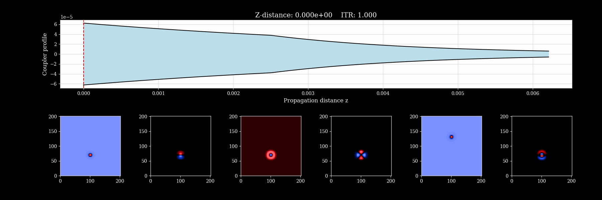

SuPyMode
========

.. list-table::
   :width: 100%
   :widths: 35 65
   :header-rows: 1

   * - Badge
     - Status
   * - Python versions
     - |mps-python|
   * - Documentation
     - |mps-docs|
   * - Tests
     - |mps-ci| |mps-coverage|
   * - PyPI
     - |mps-pypi| |mps-downloads|
   * - Conda
     - |mps-conda| |mps-conda-downloads| |mps-conda-release|

A package for light propagation in fiber optics.

Compute guided supermodes along a tapered optical component and study how a changing
cross-section couples them. Start by comparing taper profiles at fixed stretch before
solving for optical propagation.

See the `usage guide <https://github.com/MartinPdeS/SuPyMode/blob/HEAD/USAGE.rst>`__ for further examples and implementation details.
Open the `project notebook in Colab <https://colab.research.google.com/github/MartinPdeS/SuPyMode/blob/master/notebook.ipynb>`__.

   Mode propagation in a tapered photonic lantern.

Installation
------------

Requires Python ``>=3.11``.

.. code-block:: console

   $ python -m pip install SuPyMode

Install from the ``martinpdes`` Conda channel:

.. code-block:: console

   $ conda install -c martinpdes supymode

For an editable source installation:

.. code-block:: console

   $ git clone https://github.com/MartinPdeS/SuPyMode.git
   $ cd SuPyMode
   $ python -m pip install -e .

Compare taper heating lengths
-----------------------------

.. code-block:: python

   """
   Compare heating lengths
   =======================

   For the same stretch, a longer hot zone produces a gentler radius reduction.
   Distances and heating lengths are in metres; the radius is normalised to its
   initial value. This example compares profiles, not optical mode solutions.
   """

   import matplotlib.pyplot as plt
   from SuPyMode.workflow import AlphaProfile

   fig, ax = plt.subplots()
   for heating_length in (4e-3, 8e-3, 12e-3):
       profile = AlphaProfile(
           initial_radius=1.0, symmetric=False, add_end_of_taper_section=False
       )
       profile.add_taper_segment(
           alpha=0.2, initial_heating_length=heating_length, stretching_length=4e-3
       )
       profile.initialize()
       ax.plot(
           profile.distance * 1e3, profile.itr_list, label=f"{heating_length * 1e3:g} mm"
       )
   ax.set(
       xlabel="Distance (mm)",
       ylabel="Inverse taper ratio",
       title="Effect of heating length",
   )
   ax.legend(title="Heating length")
   plt.show()

Documentation
-------------

Use the `SuPyMode documentation <https://martinpdes.github.io/SuPyMode/>`__ to work through
examples and look up the inputs and return values of individual functions.

Citation
--------

Cite the `SuPyMode paper in Optics Continuum <https://opg.optica.org/optcon/abstract.cfm?uri=optcon-3-2-242>`__ when using the solver in a publication.

Contributing
------------

Bug reports, worked examples, and documentation corrections are welcome.
To set up a development checkout and run the tests, follow the `contributing guide <https://github.com/MartinPdeS/SuPyMode/blob/HEAD/CONTRIBUTING.md>`__.

Contact
-------

For questions, contact `Martin Poinsinet de Sivry-Houle <mailto:martin.poinsinet.de.sivry@gmail.com?subject=SuPyMode>`__.

License
-------

See the `SuPyMode license <https://github.com/MartinPdeS/SuPyMode/blob/HEAD/LICENSE>`__ for terms of use.

.. |mps-python| image:: https://img.shields.io/pypi/pyversions/supymode.svg
   :alt: Supported Python versions
   :target: https://pypi.org/project/supymode/

.. |mps-pypi| image:: https://img.shields.io/pypi/v/supymode.svg
   :alt: PyPI version
   :target: https://pypi.org/project/supymode/

.. |mps-downloads| image:: https://img.shields.io/pypi/dm/supymode.svg
   :alt: Monthly PyPI downloads
   :target: https://pypistats.org/packages/supymode

.. |mps-docs| image:: https://github.com/MartinPdeS/SuPyMode/actions/workflows/deploy_documentation.yml/badge.svg
   :alt: Documentation
   :target: https://martinpdes.github.io/SuPyMode/

.. |mps-ci| image:: https://github.com/MartinPdeS/SuPyMode/actions/workflows/tests.yml/badge.svg
   :alt: Tests
   :target: https://github.com/MartinPdeS/SuPyMode/actions/workflows/tests.yml

.. |mps-conda| image:: https://anaconda.org/martinpdes/supymode/badges/version.svg
   :alt: Anaconda version
   :target: https://anaconda.org/martinpdes/supymode

.. |mps-conda-downloads| image:: https://anaconda.org/martinpdes/supymode/badges/downloads.svg
   :alt: Anaconda downloads
   :target: https://anaconda.org/martinpdes/supymode

.. |mps-conda-release| image:: https://anaconda.org/martinpdes/supymode/badges/latest_release_relative_date.svg
   :alt: Latest Anaconda release
   :target: https://anaconda.org/martinpdes/supymode
